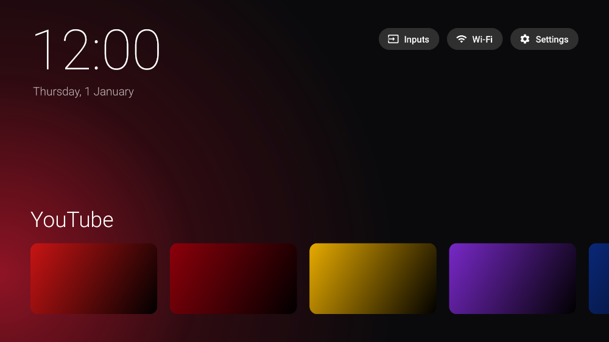
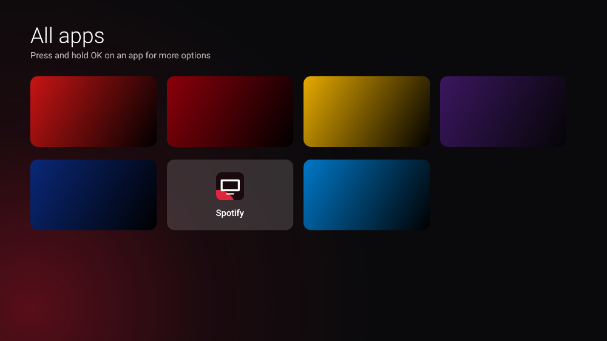

# AndroidTvDebloit

Cuci TV Android anda yang penuh iklan dan lembab, guna komputer sahaja.

- **Matikan bloatware** seperti app iklan, cadangan rancangan dan app Google yang tak digunakan.
- **Tukar home screen** kepada gaya Apple TV yang minimalis dan tanpa iklan.
- **Intro Layan.OS** dengan animasi penuh setiap kali TV dibuka.
- **Percuma, tak perlu root, dan boleh undo.** Tiada app yang dipadam kekal. Semua perubahan direkod dalam folder `backup/`.

Berfungsi untuk **Google TV** dan **Android TV** (Sony, TCL, Xiaomi, Sharp, Philips, Hisense, Chromecast, Mi Box dan lain-lain).



> Gambar di atas hanyalah contoh. Di TV anda, setiap kotak akan menunjukkan banner sebenar app anda (YouTube, Netflix, dan lain-lain).

---

## Cara paling mudah: laman web

Buka **https://dynoz769.github.io/AndroidTvDebloit/**, pilih model TV anda, dan ikut 3 langkah. Laman tersebut akan tunjuk langkah yang betul untuk TV anda, dan beri **satu arahan** (atau fail `setup.bat` untuk Windows) yang menjalankan setup penuh secara automatik.

> Pelayar web tak dibenarkan bersambung terus ke TV atas sebab keselamatan. Jadi langkah terakhir tetap perlu dijalankan dari komputer yang disambung ke Wi-Fi yang sama dengan TV.

Kalau anda lebih suka buat secara manual, ikut langkah di bawah.

---

## Apa yang anda perlukan

- Komputer **Windows**, **Mac** atau **Linux**.
- TV dan komputer disambung ke **Wi-Fi yang sama**.
- Lebih kurang 10 minit.

Tak perlu pasang apa-apa terlebih dahulu. Kali pertama skrip dijalankan, ia akan muat turun ADB rasmi dari Google secara automatik.

---

## Langkah 1: Hidupkan Developer options di TV

**Google TV:**
1. Pergi ke **Settings → System → About**.
2. Tekan **Android TV OS build** sebanyak **7 kali**, sehingga keluar mesej "You are now a developer".
3. Kembali ke **Settings → System → Developer options**.
4. Hidupkan **USB debugging**.

**Android TV (versi biasa):**
1. Pergi ke **Settings → Device Preferences → About**.
2. Tekan **Build** sebanyak **7 kali**.
3. Kembali ke **Settings → Device Preferences → Developer options**.
4. Hidupkan **USB debugging**. Ada TV yang namakannya *Network debugging* atau *ADB debugging*.

> Ada model Google TV baru yang hanya ada **Wireless debugging**. Itu pun tak mengapa, sebab skrip akan bantu anda buat *pairing* menggunakan kod 6 digit.

## Langkah 2: Cari alamat IP TV

Di TV, pergi ke **Settings → Network & Internet**, pilih Wi-Fi yang sedang digunakan, dan catat **IP address** (contoh `192.168.1.20`).

## Langkah 3: Muat turun projek ini

Tekan butang hijau **Code → Download ZIP** di atas, kemudian *extract* ZIP tersebut ke mana-mana folder.

## Langkah 4: Jalankan skrip

**Windows:** klik dua kali fail **`debloat.bat`**.

**Mac / Linux:** buka Terminal di dalam folder tersebut, kemudian taip:

```bash
bash debloat.sh
```

Masa pertama kali skrip bersambung ke TV, skrin TV akan bertanya *"Allow USB debugging?"*. Tick **Always allow**, kemudian tekan **Allow**.

---

## Menu

| No | Menu | Apa yang ia buat |
|----|------|------------------|
| 1 | Sambung ke TV | Sambung ke TV melalui Wi-Fi. Skrip akan ingat IP TV untuk kali seterusnya. |
| 2 | Cuci bloatware | Tunjuk senarai app yang akan dimatikan. Anda boleh pilih semua, atau pilih satu per satu. |
| 3 | Pasang home screen baru | Pasang **Debloit Home** (gaya Apple TV). Skrip juga boleh matikan home asal supaya butang Home terus ke home baru. |
| 4 | Undo | Pulihkan app dari mana-mana backup. |
| 5 | Buang home screen baru | Hidupkan semula home asal dan buang Debloit Home. |
| 6 | Imbas senarai app | Simpan senarai semua app dalam TV ke fail `imbas-*.txt`, untuk ditanya kepada AI. |
| 7 | Pulih kecemasan | Hidupkan semula semua app dalam senarai, walaupun folder backup sudah hilang. |
| 8 | Main intro Layan.OS | Mainkan intro di TV sekarang, untuk tengok atau tunjuk kepada kawan. |

Cadangan untuk kali pertama: **1 → 2 → 3**.

---

## Home screen baru (Debloit Home)

- Jam besar dan tarikh di atas.
- Butang **Inputs** (tukar ke HDMI), **Wi-Fi** dan **Settings**.
- Satu baris app di bawah, tanpa iklan dan tanpa "cadangan untuk anda".
- Tile **Semua app** di hujung baris untuk lihat semua app.
- **Tekan lama butang OK** pada mana-mana app untuk alih ke kiri atau kanan, alih ke depan, sembunyikan, atau buka info app.
- Teks ikut bahasa TV, sama ada Bahasa Melayu atau English.



### Intro Layan.OS

Bila TV dibuka, home screen akan mainkan intro **Layan.OS — created by Dynoz**, sekitar 5 saat. Garis cahaya akan meluncur merentasi skrin, dan huruf logo menghentak masuk satu per satu. Lepas tu ada gegaran, gelombang kejutan, percikan api dan kilauan pada logo. Akhir sekali, intro *zoom* keluar dan home screen muncul.


Bila intro dimainkan:
- Kali pertama home screen muncul selepas TV dihidupkan.
- Bila TV bangun dari *standby*. Kebanyakan TV Android tak benar-benar dimatikan bila tekan butang power, sebaliknya masuk mod *standby*.
- Bila anda pilih menu **8** dalam skrip.

Tekan mana-mana butang pada remote untuk langkau intro.

> Intro ini dimainkan oleh home screen, selepas Android selesai dimuatkan. Logo jenama TV dan animasi *boot* Android di awal tak boleh ditukar tanpa *root*.

---

## Senarai bloatware

Senarai app yang dimatikan disimpan dalam folder `senarai/`:

| Fail | Isi |
|------|-----|
| `umum.txt` | App yang selamat dimatikan pada semua Google TV / Android TV. |
| `tambahan.txt` | Pilihan tambahan (YouTube Kids, YouTube Music, Ambient mode, Meet). Skrip akan tanya dulu. |
| `saya.txt` | Senarai anda sendiri. |
| `jenama-<nama>.txt` | (Pilihan) Senarai khas untuk satu jenama, contohnya `jenama-sony.txt`. Fail ini hanya digunakan jika nama jenama TV anda sepadan. |
| `launcher-asal.txt` | Home screen asal yang dimatikan bila pasang home baru. |

Format setiap baris ialah `nama.pakej   # penerangan`. App yang tiada dalam TV anda akan dilangkau.

### Cari bloatware khas untuk TV anda dengan AI

1. Pilih menu **6) Imbas senarai app**.
2. Hantar fail `imbas-*.txt` kepada AI (contohnya Claude) dan minta:
   > Senaraikan bloatware dalam TV ini yang selamat dimatikan, dalam format: `nama.pakej   # penerangan`
3. Salin jawapan ke dalam `senarai/saya.txt`.
4. Jalankan menu **2) Cuci bloatware**.

App penting seperti Google Play Services, Play Store, Settings dan papan kekunci **sentiasa dilindungi**. Skrip tak akan matikan app ini walaupun ia ada dalam senarai.

---

## Masalah biasa

**`failed to connect` / `Connection refused`**
Semak semula bahawa *USB debugging* sudah dihidupkan, dan TV serta komputer berada pada Wi-Fi yang sama. Ada TV yang perlu dimatikan dan dihidupkan semula selepas *USB debugging* dihidupkan.

**TV tak keluar soalan "Allow"**
Matikan *USB debugging*, kemudian hidupkan semula, dan cuba menu 1 sekali lagi.

**Muat turun DebloitHome.apk gagal**
Pergi ke halaman **Releases** repo ini, muat turun `DebloitHome.apk`, dan letakkan fail tersebut dalam folder yang sama dengan skrip.

**Selepas tukar home di Google TV, ada benda yang hilang**
Home asal Google TV juga mengawal beberapa ciri lain, seperti tukar profil dan menu input. Untuk tukar ke HDMI, guna butang **Inputs** di home baru. Kalau tak suka, pilih menu **5** dan semuanya akan kembali seperti asal.

**Selepas update sistem atau factory reset**
Update sistem kadang-kadang menghidupkan semula app yang telah dimatikan. Kalau ini berlaku, jalankan menu 2 sekali lagi. Factory reset pula akan memulihkan semua app ke keadaan asal kilang.

---

## Untuk developer

- `debloat.sh` ialah skrip untuk Mac/Linux (bash), manakala `debloat.ps1` ialah skrip untuk Windows (PowerShell, dilancarkan oleh `debloat.bat`). Kedua-duanya buat perkara yang sama.
  - Tanpa pilihan, skrip buka menu penuh. Dengan `--auto` (`-Auto` untuk Windows), skrip jalankan setup penuh sekali jalan. Tambah `--jenama sony` dan `--ip 192.168.1.20` untuk tetapkan jenama dan IP terlebih dahulu.
- `web/` mengandungi laman web pemilih model (HTML, CSS dan JavaScript biasa, tanpa build). Laman ini diterbitkan ke GitHub Pages oleh workflow `pages.yml`.
  - `web/setup.sh` dan `web/setup.ps1` ialah pemasang satu-arahan yang dipanggil oleh laman web. Ia muat turun kit ke `~/AndroidTvDebloit` (atau `%USERPROFILE%\AndroidTvDebloit`), kemudian jalankan skrip dengan `--auto`.
  - Untuk tambah model TV baru, kemas kini senarai `BRANDS` dalam `web/app.js`. Untuk tambah senarai bloatware jenama, cipta `senarai/jenama-<profile>.txt`.
- `launcher/` mengandungi kod sumber Debloit Home (Kotlin, minSdk 23). Intro dilukis frame demi frame dalam `IntroView.kt`.
  - Font intro ialah [Orbitron](https://github.com/theleagueof/orbitron) (SIL Open Font License, lihat `launcher/app/src/main/assets/licenses/`).
  - Untuk bina sendiri: `cd launcher && ./gradlew assembleRelease`.
  - GitHub Actions akan bina APK setiap kali ada perubahan pada `launcher/` di branch `main`, dan terbitkan APK tersebut sebagai Release.
  - Kunci tandatangan `launcher/keystore/debloit.jks` sengaja dikongsi secara awam, supaya setiap binaan boleh dipasang di atas versi lama. Kalau anda *fork* projek ini untuk diedarkan, sila guna kunci anda sendiri.

## Penafian

Projek ini menggunakan arahan ADB rasmi (`pm disable-user`, `pm uninstall --user 0`) yang tak memadam fail sistem, dan semua perubahan boleh dipulihkan. Walaupun begitu, gunakan atas risiko sendiri.
